<div align="center">




<br/>

<a href="https://abhijith-portfolio-1.vercel.app/">

</a>
<a href="https://www.linkedin.com/in/abhijithsvijayan/">

</a>
<a href="https://github.com/codewithabhijith">

</a>


<br/><br/>



</div>


<div align="center">

</div>

```text
╔══════════════════════════════════════════════════════════╗
║  ● ● ●   abhijith@dev-machine:~$ whoami                  ║
╠══════════════════════════════════════════════════════════╣
║                                                          ║
║   name      →  Abhijith V S                              ║
║   role      →  Software Engineer                         ║
║   company   →  Dutch Cycling Project Pvt. Ltd.           ║
║   focus     →  Mobile • Web • Backend                    ║
                 • Ai Integrated development               ║
║   stack     →  Flutter • Dart • Java • Spring Boot       ║
║   mindset   →  Build > Test > Learn > Improve            ║
║                                                          ║
║   status    →  [██████████] ONLINE & BUILDING            ║
╚══════════════════════════════════════════════════════════╝
```

I'm a Software Engineer who loves turning ideas into useful digital experiences. I build mobile apps with **Flutter & Dart** and explore backend engineering with **Java, Spring Boot and MySQL**.

> ⚡ Building mobile apps and interactive user experiences
> 🚴 Contributing to a cycling and rider passport ecosystem
> 🎨 Designing web and mobile experiences for personal projects
> 🧠 Going deeper into backend systems and API integration

<div align="center">

`CREATIVITY × ENGINEERING × CONSISTENCY`

</div>


<div align="center">


<br/>


<br/><br/>


</div>


<div align="center">


### DUTCH CYCLING PROJECT PVT. LTD.

**Software Engineer · Trukom Ecosystem**

</div>

Working on a cycling-focused digital ecosystem that connects tour experiences with rider-oriented application features.

<details open>
<summary><b>▸ WHAT I WORK ON</b></summary>
<br/>

- Developing Flutter application interfaces
- Building tour details and booking experiences
- Working on package selection and reusable UI components
- Integrating application models and backend functionality

</details>

<div align="center">


<sub>Company project · Source code and internal links are intentionally not published here.</sub>

</div>


<div align="center">

</div>

<table>
<tr>
<td width="50%" valign="top">

<div align="center">


### BEOZ ELECTRONICS

**Brand · Web · Mobile**

</div>

Responsive website and mobile application built to showcase the Beoz Electronics brand and connect with customers.

- ▸ Responsive web experience
- ▸ Mobile application interface
- ▸ Brand and product presentation
- ▸ Customer-focused design

<div align="center">

<!-- Replace the URL below with the actual public Beoz repository. -->
<a href="https://github.com/codewithabhijith/codewithabhijith">

</a>

</div>

</td>
<td width="50%" valign="top">

<div align="center">


### DEVELOPER PORTFOLIO

**Personal Brand · Web**

</div>

My personal portfolio, designed to showcase my developer identity, projects and professional presence.

- ▸ Personal brand presentation
- ▸ Responsive portfolio experience
- ▸ Project and profile links
- ▸ Hosted on Vercel

<div align="center">

<a href="https://abhijith-portfolio-1.vercel.app/">

</a>

</div>

</td>
</tr>
</table>


<div align="center">


<br/>


<br/><br/>


<br/><br/>


<br/>


</div>


<div align="center">


<br/>

<a href="https://www.linkedin.com/in/abhijithsvijayan/">

</a>
<a href="https://github.com/codewithabhijith">

</a>
<a href="https://abhijith-portfolio-1.vercel.app/">

</a>

<br/><br/>


<sub>DESIGNED WITH PURPOSE · BUILT WITH CURIOSITY · POWERED BY CODE</sub>

</div>
